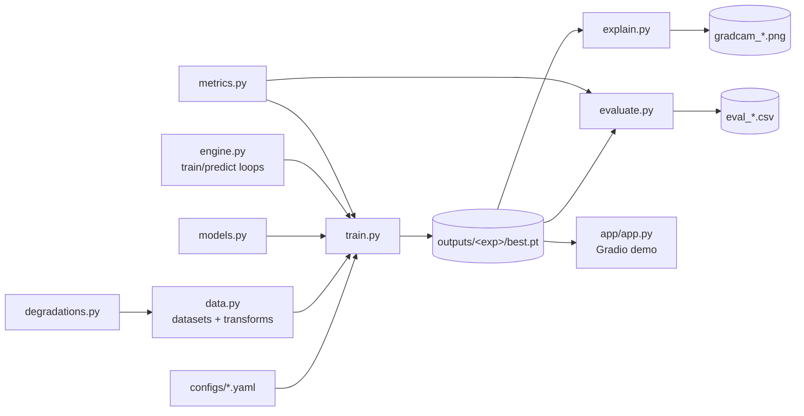

# 10 Codebase

## How the pieces fit



## Modules

| File | Responsibility | Key functions |
|---|---|---|
| `config.py` | Load YAML, inherit from `base`, apply `--set` overrides | `load_config`, `apply_overrides` |
| `data.py` | ImageFolder datasets (fake=1, real=0), transforms, subsets, loaders | `build_transform`, `make_dataset`, `build_loader` |
| `degradations.py` | Five degradations with severities 1-5; random degradation for training | `DEGRADATIONS`, `RandomDegradation` |
| `models.py` | Baseline CNN, timm models, freezing, Grad-CAM layer, checkpoint loading | `build_model`, `set_backbone_trainable`, `load_checkpoint` |
| `engine.py` | One training epoch; batched prediction; LR schedule | `train_one_epoch`, `predict`, `warmup_cosine` |
| `metrics.py` | Accuracy, precision, recall, F1, ROC-AUC, FAR, FRR | `compute_metrics` |
| `train.py` | CLI: train one experiment and save outputs | `main` |
| `evaluate.py` | CLI: clean, degraded and OOD evaluation to CSV | `main` |
| `explain.py` | CLI: Grad-CAM figure; `Explainer` class reused by the demo | `Explainer`, `main` |
| `dummy_data.py` | Tiny synthetic dataset for tests and smoke runs | `make_dummy_dataset` |

## Design decisions
- **Configs, not code edits:** every experiment is a YAML file, so runs are reproducible and easy to compare.
- **One output logit, fake = 1:** keeps metrics consistent; FAR/FRR are defined around "fake" as positive.
- **Best checkpoint by validation loss:** we never pick a model using test results.
- **Device auto-detection:** CUDA (Colab) → MPS (Mac) → CPU, with no code changes.
- **Degradations as PIL transforms:** they plug straight into torchvision pipelines, for both evaluation and augmentation.

## Common extensions

### Add a new model
Any timm model works with no code change:
```yaml
# configs/experiments/08_vit_small.yaml
base: ../base.yaml
experiment_name: 08_vit_small
model:
  name: vit_small_patch16_224
```
For Grad-CAM on a new architecture, add its last conv/feature layer to `gradcam_target_layer` in `models.py`. ViTs also need a reshape transform; see the pytorch-grad-cam docs.

### Add a new degradation
1. Subclass `Degradation` in `degradations.py`, set `levels` (5 values) and implement `apply(img)`.
2. Register it in `DEGRADATIONS`.
3. The tests in `tests/test_degradations.py` check it automatically.

### Add a new metric
Add it to the dictionary returned by `compute_metrics` in `metrics.py`. It then appears in every evaluation CSV.

## Tests
```bash
make test   # about 10 seconds
```
| Test file | Checks |
|---|---|
| `test_config.py` | Config inheritance, overrides, and that every experiment config loads |
| `test_degradations.py` | Each degradation keeps image size, changes pixels, and gets stronger with severity |
| `test_metrics.py` | FAR/FRR/accuracy on a hand-worked example |
| `test_data_and_models.py` | Labels (fake=1), loader shapes, model outputs, freezing |
| `test_pipeline.py` | End to end: train → evaluate with degradations → Grad-CAM |
